<p align="center"></p>

# Pipesmith Registry

Pipesmith Registry is a single static binary that serves the file blob stores of an existing artifact repository install in the layout that install already uses. It indexes the stores and imports the users, roles, permissions, repositories and tasks of the install. Maven, npm and Docker clients and a browser then work with the stored files through it. New uploads go into blob stores of its own, so the imported stores stay unchanged. It is meant for teams that want to move off the old service. The new server can run next to the old one first, and it keeps the artifacts readable after the old service is switched off.

## Features

Version 0.2.1. The server never writes the blob stores it imports. Writes and requests to remotes are off until you turn them on.

Serving:

- Maven repositories, groups included, under `/repository/<name>/...`.
- npm package documents and tarballs, `npm publish` with writes on.
- The Docker registry API on one port per Docker repository: pulls, and pushes with writes on.
- Every other format, PyPI and raw among them, as stored files by path.
- Proxy repositories answer from their cache. With `serve --upstream` they fetch what the cache lacks from their remote and check it against the checksum or digest of the remote before a client gets it. Groups merge Maven metadata, npm documents and Docker tag lists over their members.
- With `serve --writes`, each hosted repository writes into a blob store of its own. The imported stores stay read only.

Administration:

- Sign in with imported local users, LDAP connections and tokens. Every route checks permissions.
- An interface at `/` and a REST API under `/service/rest/v1` that create and change users, roles, LDAP connections, blob stores, repositories, routing rules, cleanup policies and tasks.
- Named tokens for npm, Docker and build tools, issued and revoked by each user.
- Cleanup policies with a preview of what a policy would remove, and tasks that run them, compact the blob stores and remove old Maven snapshots.
- The page of each blob store shows its usage, its repositories and the blobs marked for deletion, from a count the server keeps up to date.
- Log files with an audit log, log targets such as syslog, Loki or OTLP, and charts of requests and load on the overview.

Operation:

- `pipesmith-registry update` installs a new release. It checks the cosign signature and every checksum, switches to the new release and waits for its health. When the new release does not answer, it goes back by itself.
- An hourly systemd timer, off until you enable it, can fetch and install new releases from GitHub, optionally inside a time window you set. The Updates screen shows the installed version and the newest release with its notes. It also lists the history of updates.
- `serve --bind <address> --server-names NAME[,NAME]` serves on a network address once users are imported. TLS on every listener with `serve --tls-cert FILE --tls-key FILE`.
- The server reports readiness, watchdog and stopping to systemd (`Type=notify`). The unit file has not run on a Linux host yet.

Not there yet:

- Proxies keep `local-write` as their store and cannot pick another one.
- `update` and `rollback` need systemd and do not apply to the container image.
- Fetching a release from GitHub has run against a stub and the public release list, not yet with a complete signed release.
- The container image has not run on a host yet.
- The manual has no chapter yet on cleanup policies and the new task kinds; the API pages describe them.

The release notes in `docs/release-notes/` list every change and every known limit.

## Screenshots

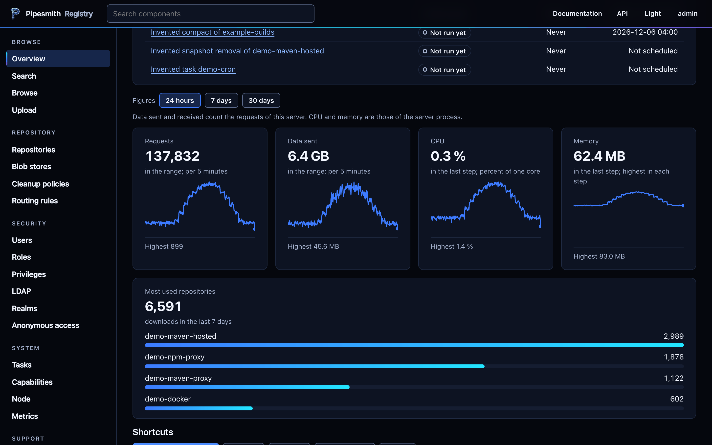

The overview shows the requests, the data sent, CPU and memory of the server for 24 hours, 7 days or 30 days, and the repositories with the most downloads.

| Updates | Blob store | Cleanup policy |
| --- | --- | --- |
| 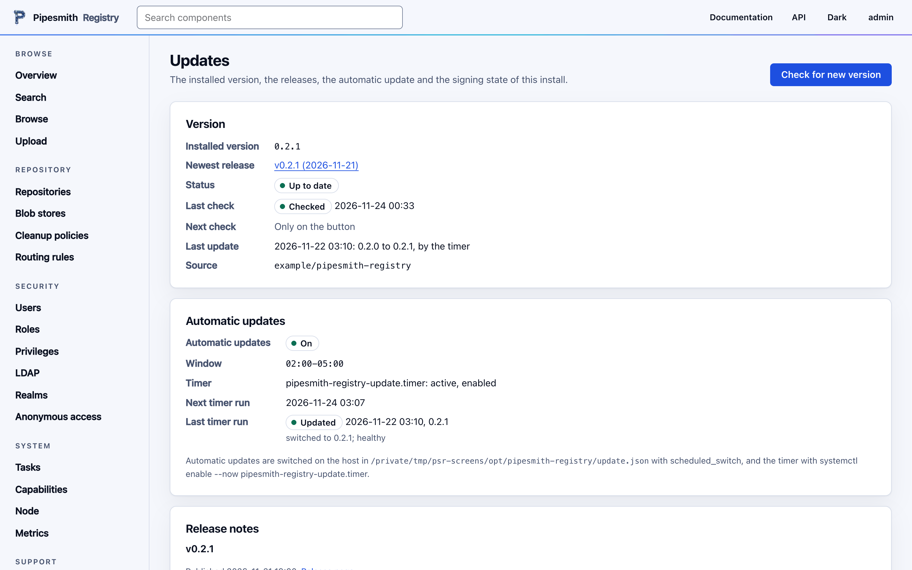 | 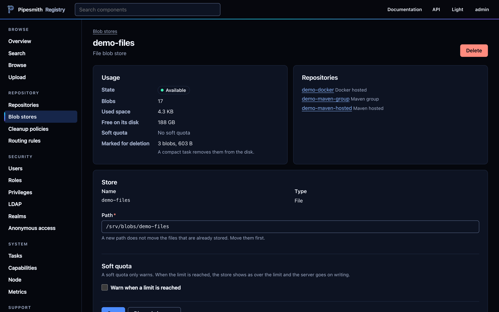 | 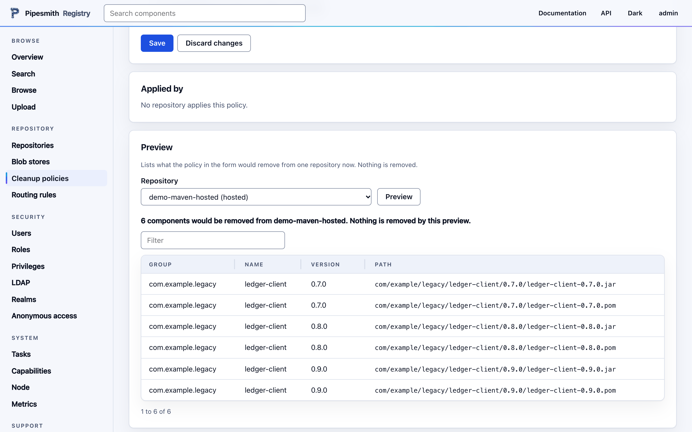 |

| Tasks | Tokens | Release notes |
| --- | --- | --- |
| 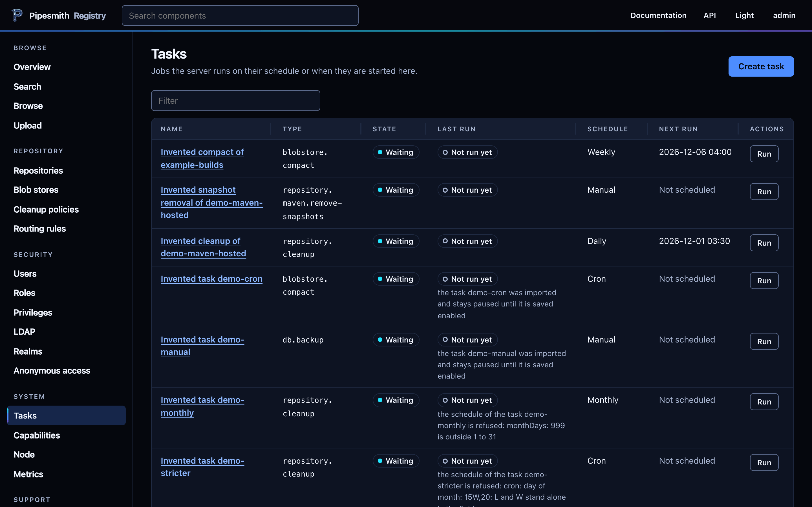 | 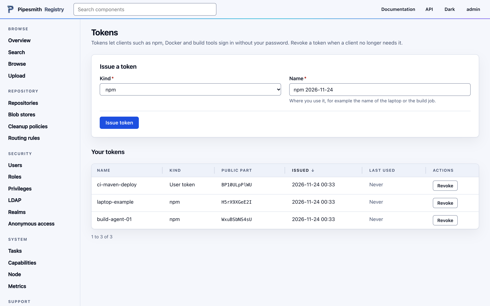 | 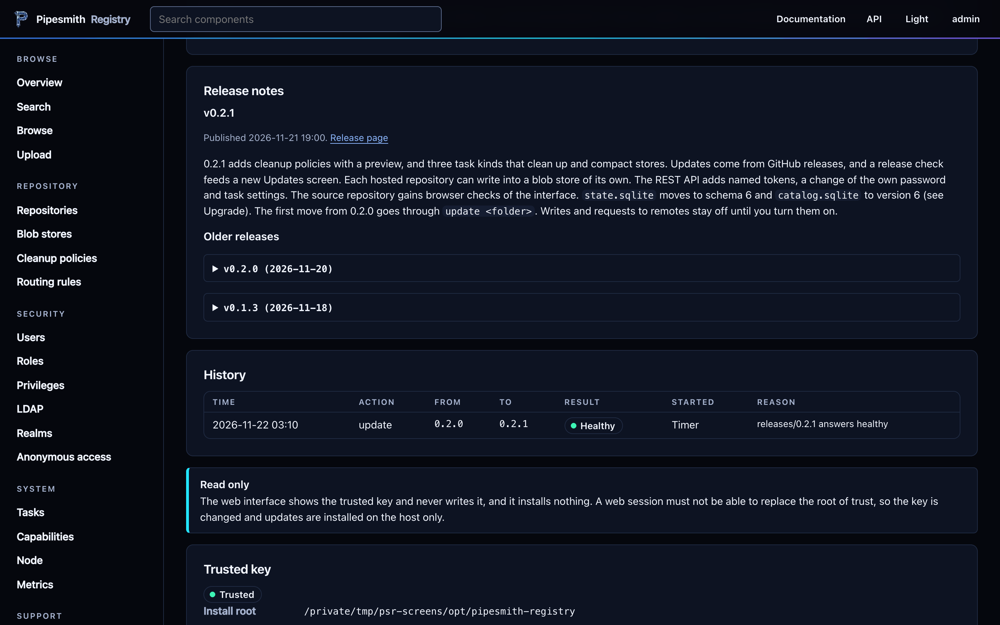 |

| Browse | Users | Proxy repository |
| --- | --- | --- |
| 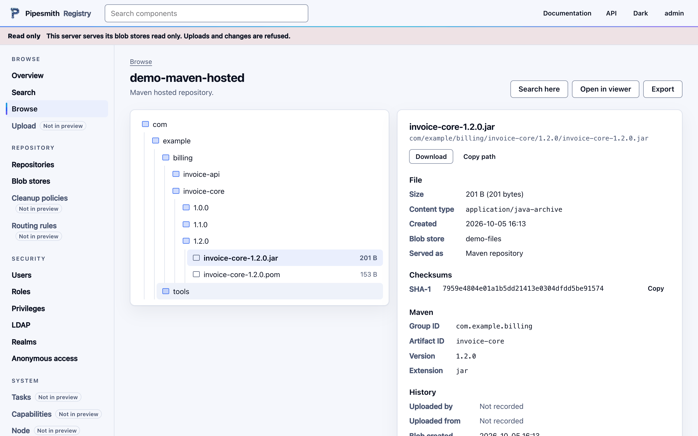 | 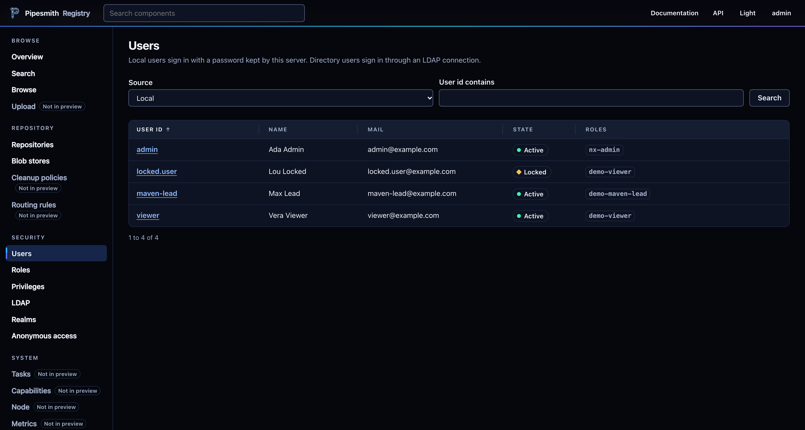 | 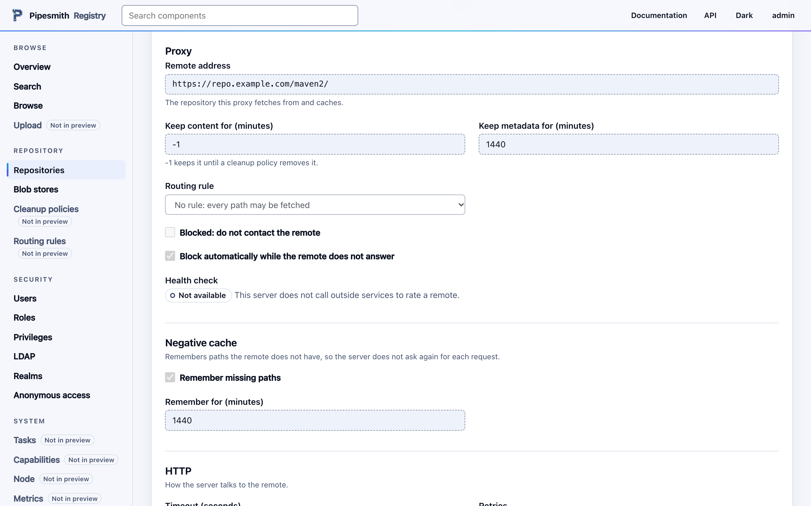 |

The screenshots show invented data.

## Architecture

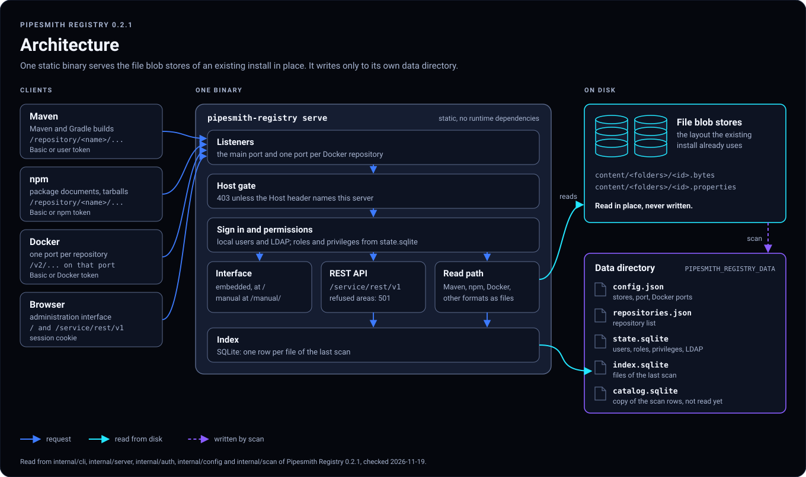

## Quick Start

The release has binaries for `linux-amd64`, `linux-arm64` and `darwin-arm64`. Download one of them with the checksum file and check it:

```bash
VERSION=0.2.1
BASE=https://github.com/iogentic/pipesmith-registry/releases/download/v$VERSION
curl -fLO "$BASE/pipesmith-registry-linux-amd64"
curl -fLO "$BASE/SHA256SUMS"
sha256sum --check --ignore-missing SHA256SUMS
chmod +x pipesmith-registry-linux-amd64
```

On macOS, use `shasum -a 256 --check --ignore-missing SHA256SUMS`.

From 0.2.0 on, `SHA256SUMS` is signed with cosign. Download the bundle and the public key of the release and check the signature:

```bash
curl -fLO "$BASE/SHA256SUMS.sigstore.json"
curl -fLO "$BASE/cosign.pub"
cosign verify-blob --key cosign.pub --bundle SHA256SUMS.sigstore.json --insecure-ignore-tlog SHA256SUMS
```

The signature is not in a transparency log, hence `--insecure-ignore-tlog`. The same key is in `release/cosign.pub` of this repository.

Attach a blob store, import the repository list, scan, and start:

```bash
export PIPESMITH_REGISTRY_DATA=/var/lib/pipesmith-registry
BIN=./pipesmith-registry-linux-amd64
$BIN store add default --kind <blob store kind> --root /srv/blobs/default
$BIN import-state --settings repository-settings.json
$BIN scan
$BIN serve --port 8793
```

`$BIN store add --help` prints the name of the blob store kind. `repository-settings.json` is the JSON list that `GET /service/rest/v1/repositorySettings` of the existing install returns. The server listens on `127.0.0.1:8793`. Open `http://localhost:8793/`.

Without imported users there is no sign in, and the server stays on the local address. The users, roles and permissions come from an export of the old database, made with `tools/h2export.sh` and read with `import`. The manual describes both steps.

## Container

The image is on Docker Hub for linux/amd64. It runs as user 65532 and keeps its data in `/data`. Put `/data` on a Docker volume:

```bash
IMAGE=iogentic/pipesmith-registry:0.2.1
docker volume create pipesmith-data
docker run --rm -v pipesmith-data:/data -v /srv/blobs/default:/stores/default:ro "$IMAGE" store add default --kind <blob store kind> --root /stores/default
docker run --rm -v pipesmith-data:/data -v "$PWD/export:/import:ro" "$IMAGE" import /import
docker run --rm -v pipesmith-data:/data -v /srv/blobs/default:/stores/default:ro "$IMAGE" scan
docker run -d --name pipesmith-registry -p 127.0.0.1:8081:8081 -v pipesmith-data:/data -v /srv/blobs/default:/stores/default:ro "$IMAGE" serve --port 8081 --bind 0.0.0.0 --server-names localhost
```

- `import` reads an export of the users made with `tools/h2export.sh`. The bind address `0.0.0.0`, which `-p` needs, works only with imported users.
- On a Docker volume the server answers from the last finished scan while a `scan` runs beside it. A user with every permission can also start a scan through the server with `POST /api/scan`.
- Avoid a data directory on a Docker Desktop share from macOS or Windows, or on NFS, SMB or FUSE. There it loses index writes when two processes use it at once. `scan` and `serve` print a warning there.

## Manual

The manual is at [iogentic.github.io/pipesmith-registry](https://iogentic.github.io/pipesmith-registry/). It has 25 chapters in four parts. Start covers Overview, First Run and Take Over. Run covers Install, Sign In, Writes, Service, Network, Container, Upgrade and Update. Use covers Maven, npm, Docker, Tokens, Raw Files, Proxies, Browse, Search and API. Reference covers Commands, Files, Security, Troubleshooting and Limits.

A running server shows the manual at `/manual/` and its API description at `/manual/api.html`. The OpenAPI document is served at `/api/openapi.json`. Every release holds the manual as a PDF, `pipesmith-registry-manual.pdf`.

## Build From Source

The build runs in the pinned Go container of `tools/go.sh`, so nothing is installed on the host. Docker must run, and `DOCKER_CONFIG` must point at a Docker configuration that asks for no credentials:

```bash
mkdir -p work/docker-quiet && printf '{}\n' > work/docker-quiet/config.json
export DOCKER_CONFIG="$PWD/work/docker-quiet"
tools/go.sh check
tools/go.sh build
```

`check` runs gofmt, `go vet` and the tests with the race detector. `build` writes the three binaries to `bin/`.

## License

Apache License 2.0. See [LICENSE](LICENSE) and [NOTICE](NOTICE).
