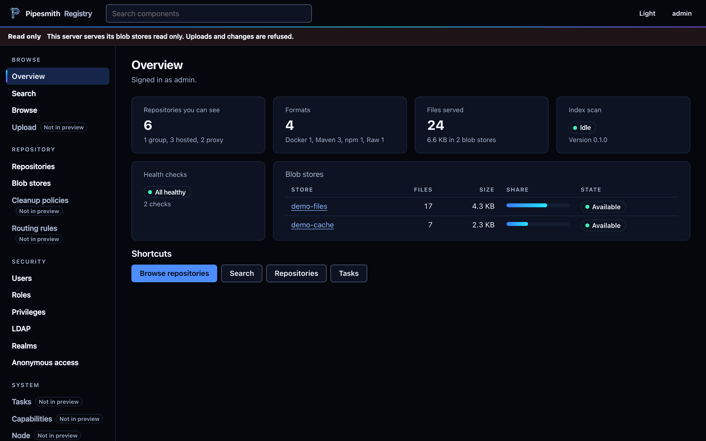
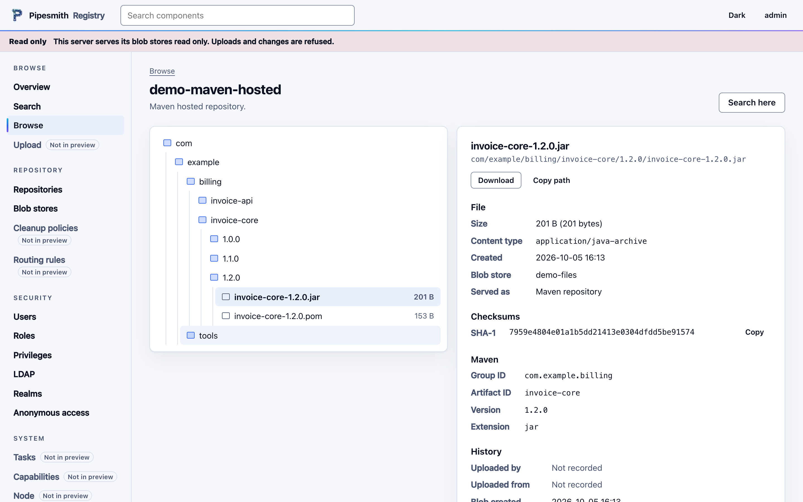
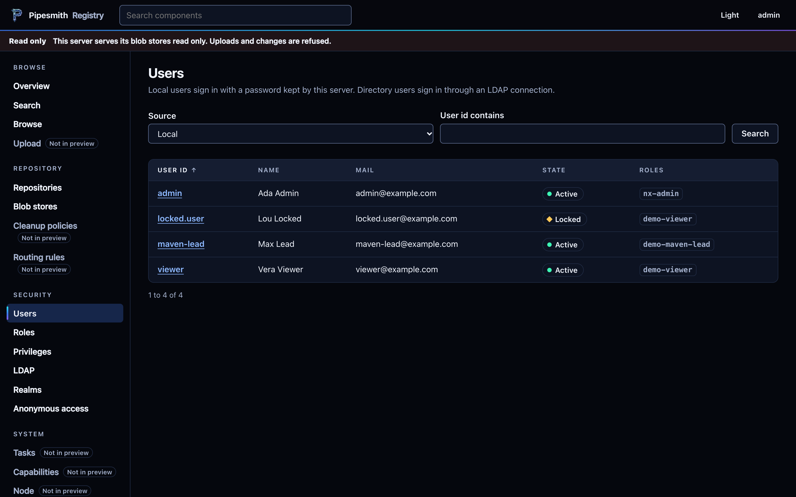
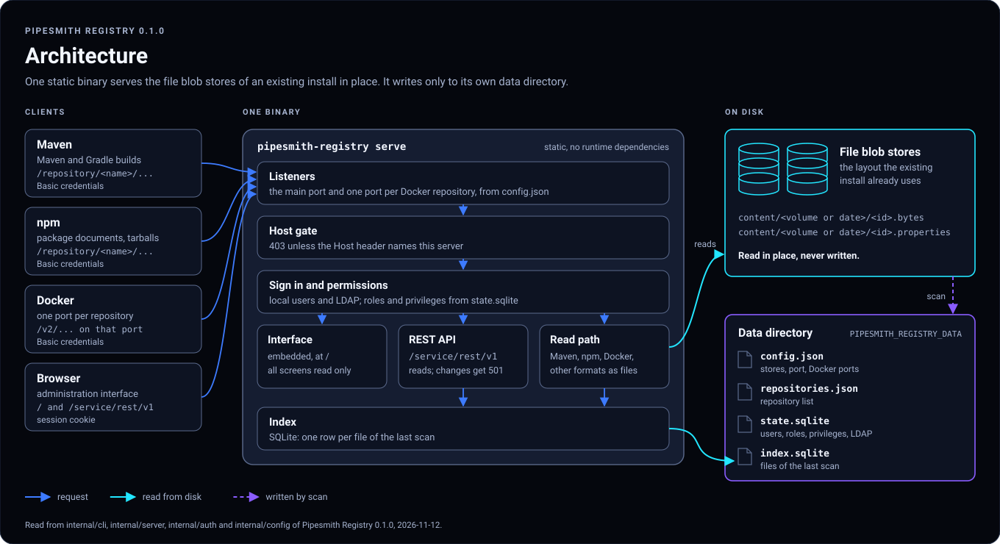

<p align="center"></p>

# Pipesmith Registry

Pipesmith Registry is a single static binary that serves the file blob stores of an existing artifact repository install, read only, in the layout that install already uses. It indexes the stores and imports the users, roles and permissions of the install. Maven, npm and Docker clients and a browser then read the stored files through it. It is meant for teams that want to read their existing artifacts through a separate server, next to the old service or after it has been switched off.

## State of 0.1

Version 0.1.0 is the first public release. It reads and never writes the blob stores.

What works:

- Maven repositories, groups included, under `/repository/<name>/...`.
- npm package documents and tarballs.
- The Docker registry API for pulls, on one port per Docker repository.
- Every other format, PyPI and raw among them, as stored files by path.
- Sign in with imported local users and LDAP, with permissions on every route.
- An administration interface at `/` and a REST API under `/service/rest/v1`. Both only read.
- `serve --bind <address> --server-names NAME[,NAME]` serves on a network address once users are imported.
- Readiness, watchdog and stopping are reported to systemd (`Type=notify`).

Not there yet:

- Uploads and deploys answer `405`, changes through the REST API answer `501`.
- Proxy and group caching: the server serves what the stores already hold.
- Tokens for Docker and npm clients. Clients send Basic credentials.
- TLS. The server speaks plain HTTP.
- Changes to the administration settings, log rotation, self update.

The systemd unit and the network bind have not run on a Linux host yet.

## Screenshots

| Overview | Browse | Users |
| --- | --- | --- |
|  |  |  |

The screenshots show invented data.

## Architecture



## Quick Start

The release has binaries for `linux-amd64`, `linux-arm64` and `darwin-arm64`. Download one of them with the checksum file and check it:

```bash
VERSION=0.1.0
BASE=https://github.com/iogentic/pipesmith-registry/releases/download/v$VERSION
curl -fLO "$BASE/pipesmith-registry-linux-amd64"
curl -fLO "$BASE/SHA256SUMS"
sha256sum --check --ignore-missing SHA256SUMS
chmod +x pipesmith-registry-linux-amd64
```

On macOS, use `shasum -a 256 --check --ignore-missing SHA256SUMS`. Release 0.1.0 is not signed. Signed releases come with the self update in a later version; the checksum only shows that the download is complete.

The container image is on Docker Hub, built for linux/amd64:

```bash
docker pull iogentic/pipesmith-registry:0.1.0
```

Attach a blob store, import the repository list, scan, and start:

```bash
export PIPESMITH_REGISTRY_DATA=/var/lib/pipesmith-registry
BIN=./pipesmith-registry-linux-amd64
$BIN store add default --kind <blob store kind> --root /srv/blobs/default
$BIN import-state --settings repository-settings.json
$BIN scan
$BIN serve --port 8793
```

`$BIN store add --help` prints the name of the blob store kind. `repository-settings.json` is the JSON list that `GET /service/rest/v1/repositorySettings` of the existing install returns. The server listens on `127.0.0.1:8793`; open `http://localhost:8793/`.

Without imported users there is no sign in, and the server stays on the local address. The users, roles and permissions come from an export of the old database, made with `tools/h2export.sh` and read with `import`. The manual describes both steps.

## Manual

The manual is at [iogentic.github.io/pipesmith-registry](https://iogentic.github.io/pipesmith-registry/). It covers install, configuration, users, the systemd service, the interface, the API, client settings, security and the limits of this release.

## Build From Source

The build runs in the pinned Go container of `tools/go.sh`, so nothing is installed on the host. Docker must run, and `DOCKER_CONFIG` must point at a Docker configuration that asks for no credentials:

```bash
mkdir -p work/docker-quiet && printf '{}\n' > work/docker-quiet/config.json
export DOCKER_CONFIG="$PWD/work/docker-quiet"
tools/go.sh check
tools/go.sh build
```

`check` runs gofmt, `go vet` and the tests with the race detector. `build` writes the three binaries to `bin/`.

## License

Apache License 2.0. See [LICENSE](LICENSE) and [NOTICE](NOTICE).
